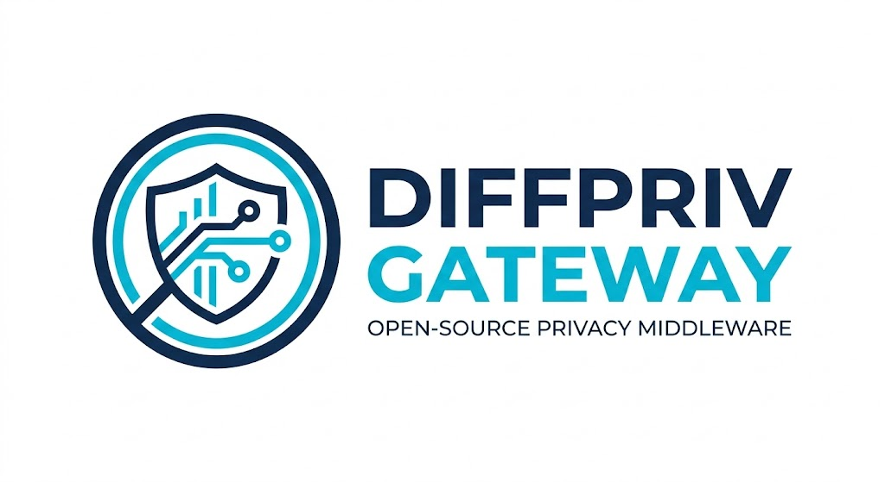

<p align="center">
  
</p>

# DiffPriv-Gateway

[](https://www.gnu.org/licenses/gpl-3.0)
[](https://www.python.org/)
[](https://github.com/Dionysis33/DiffPriv-Gateway/graphs/commit-activity)
[](https://github.com/Dionysis33/DiffPriv-Gateway/actions/workflows/python-app.yml)

DiffPriv-Gateway is an open-source Python differential privacy middleware prototype for SME analytics. It applies Laplace and Gaussian mechanisms to structured tabular data, supports privacy budget awareness and output safeguards, and includes automated tests, CI, and GDPR-oriented documentation.

> DiffPriv-Gateway is a technical and educational privacy-engineering project. It is not legal advice, is not a production privacy platform, and does not guarantee GDPR compliance by itself.

## Table of Contents

- [Problem Statement](#problem-statement)
- [Solution Overview](#solution-overview)
- [Architecture and Workflow](#architecture-and-workflow)
- [Key Features](#key-features)
- [Technology Stack](#technology-stack)
- [Installation](#installation)
- [Quick Start](#quick-start)
- [Testing and Linting](#testing-and-linting)
- [Repository Structure](#repository-structure)
- [Documentation](#documentation)
- [Limitations](#limitations)
- [Contributing](#contributing)
- [Security](#security)
- [Support](#support)
- [License](#license)

## Problem Statement

Small and medium-sized enterprises increasingly rely on data analytics for reporting, operational decisions, customer insights, and risk analysis. These workflows can involve personal, financial, payroll, loan, or other sensitive records. Basic anonymization or removing direct identifiers may not be enough to reduce re-identification risk, especially when data can be linked with other information.

SMEs often need practical privacy-aware analytics without the resources of large privacy engineering teams. DiffPriv-Gateway explores how differential privacy can be integrated into analytics workflows so useful statistical outputs can be produced while reducing disclosure risk.

## Solution Overview

DiffPriv-Gateway acts as privacy-preserving middleware between raw tabular data and analytics workflows. Instead of exposing raw values directly to downstream analysis, it applies differential privacy mechanisms and post-processing safeguards before returning protected statistical outputs.

The project is designed as a readable Python prototype for privacy engineering, experimentation, and academic portfolio use.

## Architecture and Workflow

At a high level, the workflow is:

1. Load structured tabular data from a CSV dataset.
2. Select a numerical column or query target.
3. Apply the Laplace or Gaussian differential privacy mechanism.
4. Apply clipping and output safeguards to keep results within expected bounds.
5. Return protected statistical output for analysis or demonstration.

## Key Features

- Laplace mechanism for differential privacy.
- Gaussian mechanism using `diffprivlib`.
- Privacy budget awareness through parameters such as `epsilon` and `delta`.
- Clipping and bounds control for protected outputs.
- Modular Python privacy engine in `src/privacy_engine.py`.
- Synthetic and demo data support under `data/synthetic/`.
- Automated validation with `pytest`.
- Code quality checks with `flake8`.
- GitHub Actions CI for automated test and lint execution.
- GDPR-oriented documentation that discusses privacy-by-design concepts without claiming automatic legal compliance.

## Technology Stack

- Python 3.12
- pandas
- NumPy
- diffprivlib
- pytest
- flake8
- GitHub Actions

## Installation

### Windows PowerShell

```powershell
git clone https://github.com/Dionysis33/DiffPriv-Gateway.git
cd DiffPriv-Gateway
python -m venv .venv
.\.venv\Scripts\Activate.ps1
pip install -r requirements.txt
```

For development and validation tools:

```powershell
pip install -r requirements-dev.txt
```

### Linux and macOS

```bash
git clone https://github.com/Dionysis33/DiffPriv-Gateway.git
cd DiffPriv-Gateway
python3 -m venv .venv
source .venv/bin/activate
pip install -r requirements.txt
```

For development and validation tools:

```bash
pip install -r requirements-dev.txt
```

## Quick Start

### Windows PowerShell

```powershell
git clone https://github.com/Dionysis33/DiffPriv-Gateway.git
cd DiffPriv-Gateway
python -m venv .venv
.\.venv\Scripts\Activate.ps1
pip install -r requirements.txt
python main.py
```

### Linux and macOS

```bash
git clone https://github.com/Dionysis33/DiffPriv-Gateway.git
cd DiffPriv-Gateway
python3 -m venv .venv
source .venv/bin/activate
pip install -r requirements.txt
python main.py
```

## Testing and Linting

Run the automated tests:

```bash
python -m pytest -v
```

Run lint validation:

```bash
python -m flake8 --exclude=.venv,__pycache__ main.py src tests
```

## Repository Structure

```text
DiffPriv-Gateway/
|-- .github/
|   |-- workflows/
|   |   `-- python-app.yml
|   |-- CODE_OF_CONDUCT.md
|   |-- CONTRIBUTING.md
|   |-- SECURITY.md
|   `-- SUPPORT.md
|-- assets/
|   `-- logo.png
|-- data/
|   `-- synthetic/
|-- docs/
|   |-- gdpr_analysis_privacy_by_design.md
|   |-- literature_review.md
|   `-- presentation/
|-- notebooks/
|-- src/
|   |-- __init__.py
|   `-- privacy_engine.py
|-- tests/
|   |-- test_basic.py
|   `-- test_privacy_engine.py
|-- main.py
|-- requirements.txt
|-- requirements-dev.txt
|-- README.md
`-- LICENSE
```

## Documentation

Additional project documentation is available in the `docs/` directory, including GDPR-oriented analysis, privacy-by-design discussion, literature notes, and presentation material.

Relevant files include:

- [GDPR analysis and Privacy by Design](docs/gdpr_analysis_privacy_by_design.md)
- [Literature review](docs/literature_review.md)
- [Documentation site entry point](docs/index.html)

## Limitations

- This is a prototype and academic portfolio project.
- The included datasets are synthetic or demo-oriented.
- The project is not a production privacy platform.
- Differential privacy configuration still requires careful parameter selection and domain review.
- The project is not legal advice and does not guarantee GDPR compliance by itself.
- Real deployments would require governance, consent management, access control, security hardening, monitoring, and legal review.

## Contributing

Contributions are welcome in focused areas such as documentation, tests, privacy mechanism validation, and code quality improvements. See [.github/CONTRIBUTING.md](.github/CONTRIBUTING.md) for the contribution guide.

## Security

Please do not report security or privacy vulnerabilities through public GitHub issues. See [.github/SECURITY.md](.github/SECURITY.md) for supported reporting guidance and responsible disclosure expectations.

## Support

For documentation, questions, bug reports, feature requests, and security or privacy reporting guidance, see the [Support guide](.github/SUPPORT.md).

## License

This project is distributed under the GPL v3 license. See [LICENSE](LICENSE) for details.
